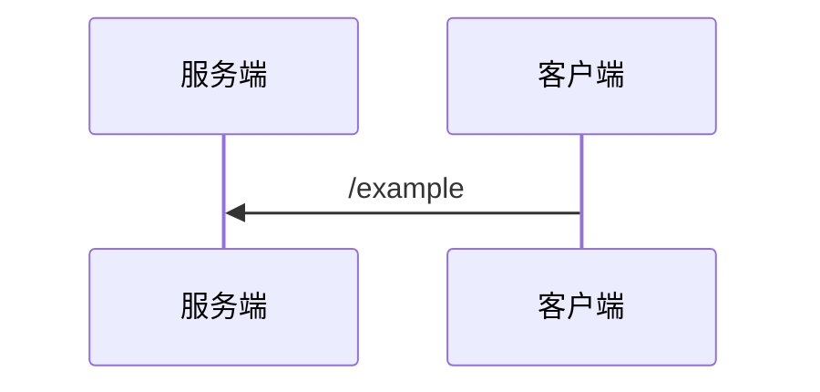

# pdf2md

纯 Python 的 PDF → Markdown 转换工具，重点处理两类文档：

- 带水印、由 Chrome/Skia 渲染生成的带版式 PDF；
- 以矢量方式绘制的时序图、流程图（不是位图截图）。

转换结果保留标题层级、表格、代码块、列表和图片；时序图和流程图会优先转换为 Mermaid，无法可靠识别时自动回退为 300dpi 原图。

## 特性

- **去水印**：基于 pikepdf 删除指定字体/字号的水印 Form XObject，不改变正文。
- **版式恢复**：识别标题、段落、列表、网格表格、代码块和跨页续表。
- **图表语义化**：
  - 时序图：参与者、生命线、实线/虚线消息、自循环、黄色备注、`alt/else`、`opt`、`loop`、`par/and` 框；
  - 流程图：节点、正交连线、双向箭头、边标签。
- **保真兜底**：每张图同时保存 300dpi PNG；Mermaid 转换失败时直接引用原图。
- **无 AI/OCR/外部服务**：只依赖 PyMuPDF 的矢量与文本解析。

## 环境

- Python 3.10+
- PyMuPDF
- pikepdf

```bash
pip install -r requirements.txt
```

## 使用

先去除水印（如源 PDF 无水印可跳过）：

```bash
python clean_watermark.py input.pdf cleaned.pdf
```

再转换为 Markdown：

```bash
python convert.py cleaned.pdf output.md assets p1
```

参数依次为：

1. 输入 PDF
2. 输出 Markdown
3. 图片资产目录
4. 资产文件名前缀（用于区分多份文档）

示例输出：

````markdown


<details>
<summary>原图（p013，时序图）</summary>


</details>
````

只想保留 Mermaid、不附原图时，把 `convert.py` 中的：

```python
KEEP_SOURCE_IMAGE = True
```

改为 `False`。

## 文件说明

| 文件 | 作用 |
| --- | --- |
| `clean_watermark.py` | 删除 PDF 中指定字体/字号的水印 XObject |
| `convert.py` | PDF 页面分析、表格/代码/标题恢复、Markdown 输出 |
| `mermaid_diagram.py` | 矢量时序图/流程图 → Mermaid，含置信度校验与回退 |
| `requirements.txt` | Python 依赖 |
| `tools/` | 字体、代码块、表格网格等诊断脚本，详见 `tools/README.md` |

## 诊断工具

`work` 目录中的排查脚本已整理到 `tools/`：

- `pdf_inspect.py`：元数据、前几页文本/图片块
- `scan_fonts.py`：字体/字号/颜色统计
- `scan_code.py`：代码块容器与内容抽样
- `analyze.py`：水印、等宽字体页面统计
- `inspect_grid.py`：表格横竖线与单元格坐标
- `inspect_tables.py`：`find_tables()` 结果对比

用法见 `tools/README.md`。


## 已知限制

- 版式分析与水印规则是启发式的，针对 Chrome/Skia 渲染的中文标准类文档调校；不同生成器/水印字体可能需要调整阈值。
- 分层架构图、思维导图等不适合用 Mermaid 表达时，保留 300dpi 原图。
- 流程图转 Mermaid 后语义一致，但自动布局与原图位置会有差异。
- Mermaid 渲染端需支持 Mermaid 10+（`<-->`、`par/and` 等语法）。

## 生成物

以下内容默认不提交到仓库：

- `*.pdf`
- `out*.md`
- `assets*/`
- `clean/`
