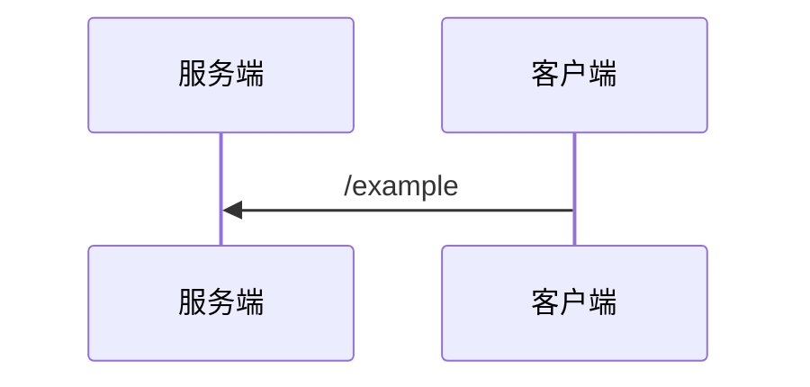

# pdf2md

纯 Python 的 PDF → Markdown 转换工具，重点处理两类文档：

- 带水印、由 Chrome/Skia 渲染生成的带版式 PDF；
- 以矢量方式绘制的时序图、流程图（不是位图截图）。

转换结果保留标题层级、表格、代码块、列表和图片；时序图和流程图会优先转换为 Mermaid，无法可靠识别时自动回退为 300dpi 原图。

## 特性

- **去水印**：基于 pikepdf 删除指定字体/字号的水印 Form XObject，不改变正文。
- **版式恢复**：识别标题、段落、列表、网格表格、代码块和跨页续表（按列坐标续接，支持跨 3 页以上）。
- **图表语义化**：
  - 时序图：参与者、生命线、实线/虚线消息、自循环、黄色备注、`alt/else`、`opt`、`loop`、`par/and` 框；
  - 流程图：节点、正交连线、双向箭头、边标签。
- **保真兜底**：无法转成 Mermaid 的图保存为 300dpi PNG 并直接引用；默认不为已转换成功的图保留原图。
- **无 AI/OCR/外部服务**：只依赖 PyMuPDF 的矢量与文本解析。

## 环境

- Python 3.10+
- PyMuPDF
- pikepdf

```bash
pip install -r requirements.txt
```

## 使用

先去除水印（如源 PDF 无水印可跳过）：

```bash
python clean_watermark.py input.pdf cleaned.pdf
```

再转换为 Markdown：

```bash
python convert.py cleaned.pdf output.md assets p1
```

参数依次为：

1. 输入 PDF
2. 输出 Markdown
3. 图片资产目录
4. 资产文件名前缀（用于区分多份文档）

示例输出：

````markdown


<details>
<summary>原图（p013，时序图）</summary>


</details>
````

默认只输出 Mermaid，不附原图（也不为转成功的图渲染 PNG）。若要在 Mermaid 后附带可折叠的原图：

- 代码调用：`Converter(..., keep_source_image=True)` 或 `convert_document(..., keep_source_image=True)`；
- 改默认值：把 `convert.py` 中的 `KEEP_SOURCE_IMAGE = False` 改为 `True`。

`convert.py` 结束时打印一行 JSON 统计（页数、表格数、Mermaid 数、字符数等）。

## 作为 MCP 服务器使用

`mcp_server.py` 暴露 4 个工具（stdio 传输）：

| 工具 | 作用 |
| --- | --- |
| `pdf_probe(path)` | 预检：页数、字符数、空页、矢量绘制数、图片数、是否有水印、是否适合转换 |
| `pdf_to_markdown(input_pdf, output_md?, assets_dir?, prefix?, clean_watermark_first=True, keep_source_image=False)` | 主转换，返回统计 |
| `pdf_batch(input_dir, pattern="*.pdf")` | 批量转换（产出与源文件同目录） |
| `pdf_clean_watermark(input_pdf, output_pdf?)` | 只去水印，返回删除次数 |

先自检：

```bash
.venv/Scripts/python.exe -c "import mcp_server; print('ok')"
```

注册到 Claude Code（仓库内 `.mcp.json` 已写好，需在项目目录启动）：

```bash
claude mcp add pdf2md -- "D:\WORK_FILE\own_file\pdf2md\.venv\Scripts\python.exe" "D:\WORK_FILE\own_file\pdf2md\mcp_server.py"
```

已打包 exe 时（分发给不装 Python 的机器）：

```bash
claude mcp add pdf2md -- "D:\WORK_FILE\own_file\pdf2md\dist\pdf2md.exe" "mcp"
```

注册到 opencode：仓库根目录的 `opencode.json` 已含 `mcp.pdf2md`；若仓库路径变化，改 `command` 与 `cwd` 两处绝对路径即可。

## 作为 Skill 使用

仓库内已带同名 Skill，agent 会自动加载：

- `.opencode/skills/pdf2md/SKILL.md`（opencode）
- `.claude/skills/pdf2md/SKILL.md`（Claude Code）

两份内容一致，说明适用判定、工具参数、验收清单与已知限制。修改时请同步两份。

## 打包成 exe（目标机免装 Python）

```powershell
.\.venv\Scripts\python.exe -m pip install pyinstaller
.\.venv\Scripts\python.exe -m PyInstaller pdf2md.spec --noconfirm
```

产物 `dist\pdf2md.exe`：单文件约 120 MB，内含 Python 运行时、PyMuPDF（含 muPDF DLL）、pikepdf（qpdf 静态链接）和 MCP SDK，目标机器无需安装任何环境。

```powershell
pdf2md.exe probe   input.pdf
pdf2md.exe clean   input.pdf cleaned.pdf
pdf2md.exe convert input.pdf -o out.md --assets out_assets --prefix p1
pdf2md.exe mcp                    # MCP stdio 服务器
```

opencode 使用时把 `opencode.json` 的 `command` 换成 `["<路径>\\pdf2md.exe", "mcp"]`，`cwd` 可省略。

注意事项：

- 单文件版每次启动会解压到临时目录，冷启动约 5 秒；MCP 进程常驻，只付一次
- 需要秒级启动就在 `pdf2md.spec` 末尾改用 onedir（`COLLECT`）写法，产物是目录 + exe
- exe 只能在与构建环境同平台时运行；Windows exe 必须在 Windows 上构建
- 打包后的进程处于隔离模式，`PYTHONIOENCODING` 等环境变量不生效，因此管道输出由 `cli.py` 强制为 UTF-8，控制台保持系统编码

## 文件说明

| 文件 | 作用 |
| --- | --- |
| `clean_watermark.py` | 删除 PDF 中指定字体/字号的水印 XObject；提供 `has_watermark()` / `count_watermarks()` / `remove_watermark()` |
| `convert.py` | PDF 页面分析、表格/代码/标题恢复、Markdown 输出；对外 API 为 `run_conversion()` / `convert_document()` |
| `probe.py` | PDF 预检：文本层/矢量图/水印/是否适合转换 |
| `cli.py` | 统一命令行入口（`probe` / `clean` / `convert` / `mcp`），也是打包入口 |
| `pdf2md.spec` | PyInstaller 打包配置 |
| `mermaid_diagram.py` | 矢量时序图/流程图 → Mermaid，含置信度校验与回退 |
| `mcp_server.py` | MCP 服务器（stdio），暴露上述 4 个工具 |
| `requirements.txt` | Python 依赖（`mcp` 仅 MCP 服务器需要） |
| `.mcp.json` / `opencode.json` | Claude Code / opencode 的 MCP 注册配置（含本机绝对路径） |
| `.opencode/skills/`、`.claude/skills/` | 仓库内 Skill |
| `tools/` | 字体、代码块、表格网格等诊断脚本，详见 `tools/README.md` |

## 诊断工具

`work` 目录中的排查脚本已整理到 `tools/`：

- `pdf_inspect.py`：元数据、前几页文本/图片块
- `scan_fonts.py`：字体/字号/颜色统计
- `scan_code.py`：代码块容器与内容抽样
- `analyze.py`：水印、等宽字体页面统计
- `inspect_grid.py`：表格横竖线与单元格坐标
- `inspect_tables.py`：`find_tables()` 结果对比

用法见 `tools/README.md`。


## 已知限制

- 版式分析与水印规则是启发式的，针对 Chrome/Skia 渲染的中文标准类文档调校；不同生成器/水印字体可能需要调整阈值。
- 分层架构图、思维导图等不适合用 Mermaid 表达时，保留 300dpi 原图。
- 流程图转 Mermaid 后语义一致，但自动布局与原图位置会有差异。
- Mermaid 渲染端需支持 Mermaid 10+（`<-->`、`par/and` 等语法）。

## 生成物

以下内容默认不提交到仓库：

- `*.pdf`
- `out*.md`
- `assets*/`
- `clean/`
